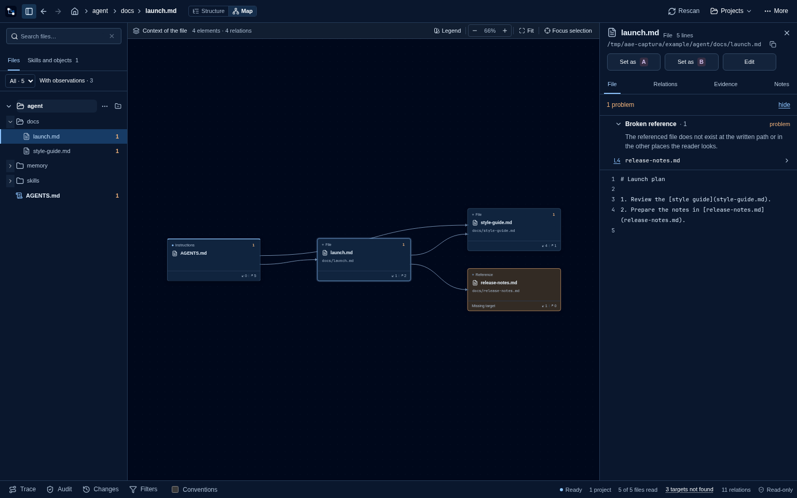

# Agent Architecture Explorer

**In English.** Agent Architecture Explorer is a local Linux app that reads the agent context files of a project (`AGENTS.md`, `CLAUDE.md`, memory, skills, subagents and the documents they point to) and maps how they reference each other, with the file, line and excerpt of every explicit reference. It audits missing and ambiguous references, shows what changed on disk since a baseline, edits a Markdown document in place when you turn editing on for a project, and creates a new agent directory from explicit primitives. Reading is deterministic, read-only and offline. The interface is in English, with Portuguese as an option under **More**; the `aae` CLI writes JSON for scripts and CI. Requirements: Linux, Python 3.10+, Node 22.12+ to build. Install with `npm ci && npm run build && python3 scripts/install.py`, then run `agent-architecture-explorer`. The rest of the documentation is in Portuguese for now; issues and pull requests in English are welcome.

Aplicativo local para ler, mapear, auditar, editar e criar **agent context files** (arquivos de contexto de agentes): os arquivos que um harness de agente de código entrega ao modelo como contexto, como `AGENTS.md`, `CLAUDE.md`, memória, skills e subagentes, e os documentos que eles apontam. A arquitetura é como esses arquivos se referenciam, e o Explorer a mostra a partir das referências explícitas escritas neles.



O mapa de um arquivo, a observação de uma referência ausente e a evidência com a linha, num agente de exemplo sintético.

## Por quê

A arquitetura de um agente moderno vive em arquivos (`AGENTS.md`, `CLAUDE.md`, skills, memórias, manifestos) que se citam uns aos outros. Quando ela cresce, fica difícil responder com certeza: **para onde este arquivo aponta? Quem aponta para ele? Qual o menor caminho de A até B?** O Explorer lê os diretórios, extrai só referências explícitas e mostra cada relação com arquivo, linha e trecho de evidência, sem inferência e sem executar nada do que lê.

## O que faz

- **Inspeção:** árvore, busca e um mapa contextual (não um grafo global) com as relações de entrada e saída de cada arquivo e a evidência de cada uma; várias raízes abertas, com pai/filho e nível.
- **Caminho:** menor caminho entre dois arquivos, no sentido das referências ou em ambos os sentidos.
- **Auditoria:** referências ausentes, ambiguidades, limites de leitura, documentos sem caminho a partir das entradas e sinais estruturais (ciclos, repetições, muitas saídas).
- **Alterações:** o que mudou no disco desde uma leitura de referência, por arquivo, relação e observação.
- **Criação:** um diretório novo com primitivos (agente, memória, ferramenta, política…) e relações explícitas, revisado antes de gravar e nunca sobrescrevendo.
- **Edição, desligada por padrão:** corrigir no inspetor um documento Markdown que a leitura aponta, com a permissão ligada por projeto, conflito conferido pelo hash do disco e desfazer da última gravação.
- **CLI `aae`:** auditoria compacta, contratos de requisitos amarrados ao conteúdo, delta entre revisões e inventário de arquivos, em JSON, para scripts, CI e agentes de código.

A inspeção é somente leitura, determinística e funciona offline. Interface em inglês, com português como opção no menu **More**, e tema escuro por padrão.

## Instalar e executar

Requisitos: Linux (o único sistema suportado), Python 3.10+, Node 22.12+ (só para o build) e Chromium (ou outro navegador, para a janela do aplicativo). A inspeção instalada não depende de Node, CDN ou internet.

```sh
npm ci
npm run build
python3 scripts/install.py
agent-architecture-explorer
```

O instalador copia o aplicativo para `~/.local/share/agent-architecture-explorer`, cria os comandos `agent-architecture-explorer` e `aae` em `~/.local/bin` e um atalho no menu de aplicativos. Os dois comandos chamam `/usr/bin/python3`, que precisa ser o Python 3.10+ do sistema; um Python de outro lugar (pyenv, conda, venv) não é usado. Chamá-los pelo nome no terminal depende de `~/.local/bin` estar no `PATH`; senão, use o caminho completo (`~/.local/bin/agent-architecture-explorer`). O atalho do menu não depende do `PATH`. Uso, estado e remoção: [guia de uso](docs/guia-de-uso.md).

## CLI

```sh
python3 -B -m server.cli schema                          # contratos e exemplos, em JSON (após instalar: aae schema)
python3 -B -m server.cli audit --root CAMINHO --summary  # auditoria estrutural compacta
python3 -B -m server.cli compare-audit --before A.json --after B.json
```

Referência completa: [docs/cli.md](docs/cli.md).

## Documentação

| Documento | Para quê |
| --- | --- |
| [Guia de uso](docs/guia-de-uso.md) | Interface, instalação e estado |
| [Modelo e leitura](docs/modelo-e-leitura.md) | O que vira relação, resolução, escopo, auditoria e limites |
| [CLI](docs/cli.md) | Contratos, comandos e códigos de saída |
| [SPECS](SPECS.md) | Requisitos e contratos do produto |
| [Contribuir](CONTRIBUTING.md) | Desenvolvimento, testes e política de evidências |
| [Índice completo](docs/README.md) | Demais documentos |

## Desenvolver com agentes de código

O repositório traz instruções para quem contribui usando um agente de código:

- [AGENTS.md](AGENTS.md): as regras do projeto para qualquer agente (Codex, Cursor, Claude Code e outros). Diz o que não pode mudar, onde alterar cada função e como verificar. É o equivalente do [guia de contribuição](CONTRIBUTING.md) para agentes.
- [CLAUDE.md](CLAUDE.md) e `.claude/`: o que é específico do Claude Code. O `CLAUDE.md` importa o `AGENTS.md`. A pasta `.claude/` libera as verificações do projeto, bloqueia a edição de `dist/`, pede confirmação antes de push, de remotes e do instalador e traz a skill `run-isolated`, que sobe o app com estado temporário.

Esses arquivos servem só a quem desenvolve: o aplicativo não os lê. Os `AGENTS.md` e `CLAUDE.md` que ele mostra são os dos diretórios que você abre.

## Estado do projeto

Em desenvolvimento ativo, sob a licença MIT ([LICENSE](LICENSE)). Mudanças em [CHANGELOG.md](CHANGELOG.md).

Defeitos e propostas vão para as issues deste repositório; para contribuir com código, veja o [CONTRIBUTING.md](CONTRIBUTING.md) e o [código de conduta](CODE_OF_CONDUCT.md). Uma vulnerabilidade é relatada em privado, como diz o [SECURITY.md](SECURITY.md).
